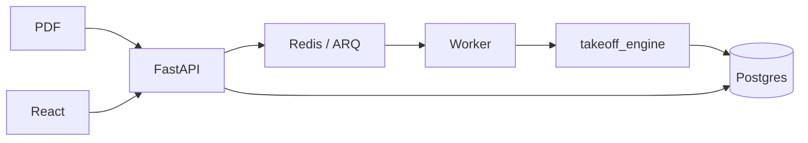

# AI Electrical Takeoff

Take a residential **vector** electrical plan PDF (four sheets), analyze each sheet,
and produce a takeoff you can **see and correct on the drawing**: detections with type
and room, per-room counts, optional bill of materials (boxes, cable length, priced
lines), and an append-only corrections log.

Demo plans: City of Escondido PAADU public-domain set —
`data/plans/escondido_plans.pdf`.

| | |
|---|---|
| Spec (source of truth) | [`docs/SPEC.md`](docs/SPEC.md) |
| Architecture (diagrams) | [`docs/architecture.md`](docs/architecture.md) |
| Counting rules | [`coordination/DECISIONS.md`](coordination/DECISIONS.md) |
| Agent ownership | [`AGENTS.md`](AGENTS.md) |
| Releases | [`CHANGELOG.md`](CHANGELOG.md) · git tags `v0.5.0`, … |

Current engine: **`PIPELINE_VERSION` = `0.5.0`**. Behavior changes still need Santiago’s approval (`AGENTS.md` §14).

---

## What it is

1. **Load** a multi-page electrical PDF and treat each page as one sheet.
2. **Detect** components (ceiling fans, lights, switches, receptacles, exhaust fans,
   detectors, junction boxes) with position and room.
3. **Count** per room and per plan (`category` and `category.subtype` keys).
4. **Draw** every detection on the plan so every number traces back to a mark.
5. **CRUD** on the plan (add / move / change type or room / soft-delete); counts and
   BOM update immediately; corrections are logged.

Stack: Python 3.12 engine + FastAPI/ARQ/Postgres/Redis backend + React (Vite) UI,
orchestrated with Docker Compose.

---

## Architecture (summary)

**Hybrid detection:** PyMuPDF geometry finds **where** symbols and rooms are. The sheet
legend (rules + optional Claude) decides **what**. Claude **never** returns coordinates —
only labels, confidence, and short reasons — so marks stay exact on the vector plan.

**Counting:** only `compute_takeoff` in the engine (mirrored in `web/src/lib/takeoff.ts`).

**Jobs:** upload enqueues one ARQ job per sheet; the worker runs `analyze_sheet` and
persists a versioned `SheetResult` into Postgres. The UI overlays that result and writes
corrections through the API.

Full Mermaid diagrams: [`docs/architecture.md`](docs/architecture.md).



---

## Run with Docker

Requirements: [Docker Desktop](https://www.docker.com/products/docker-desktop/).

```bash
cp .env.example .env
# optional: ANTHROPIC_API_KEY=... for LLM legend / adjudication

docker compose up -d --build
docker compose ps
```

| Service | URL / role |
|---------|------------|
| **web** | http://localhost:5173 |
| **api** | http://localhost:8000/docs · `/api/health` |
| **worker** | ARQ consumer (`analyze_sheet_job`) |
| **db** | Postgres 16 |
| **redis** | Redis 7 |

Defaults: `ENGINE=real` (real pipeline). Use `ENGINE=fake` only in tests / offline.

Backend image (`backend/Dockerfile`) installs deps into **`/opt/venv` inside the image**
so api/worker never write a Linux venv onto your Windows `.venv`. Only `storage/` and
`.cache/` are bind-mounted.

```bash
make demo          # upload demo PDF (stack must be up)
make down          # stop
make logs          # follow logs
```

Local (non-Docker) engine/frontend:

```bash
uv sync --all-packages --group dev
cd web && corepack enable && pnpm install && pnpm dev
```

---

## CLI and eval

`--page` is the **plan number 1..4** (Plan 1 = first sheet). Internally `page_index` is 0-based.

```bash
uv run takeoff --version
uv run takeoff analyze data/plans/escondido_plans.pdf --page 1 --out out/plan1.json --debug
uv run takeoff analyze data/plans/escondido_plans.pdf --page 2 --out out/plan2.json --no-llm
uv run takeoff eval --pdf data/plans/escondido_plans.pdf --out eval/reports
uv run takeoff eval --results-dir out --out eval/reports
uv run takeoff schema
uv run pytest
```

Eval writes `eval/reports/latest.{md,json}` and overlay PNGs. Ground-truth templates:
`eval/ground_truth/plan{1..4}.counts.yaml` (see `eval/COMO_CONTAR.md`). Regression:
`uv run python -m eval.regression`.

---

## AI usage (Claude)

| Task | Model (default) | Role |
|------|-----------------|------|
| `interpret_legend` | `ANTHROPIC_MODEL` → `claude-sonnet-5-5` | Map legend rows → category/subtype |
| `adjudicate` | same | Label ambiguous candidates only |
| `baseline_vision_takeoff` | same | Eval “LLM alone” baseline |

**Why Claude never returns coordinates:** plans are vector; geometry already has exact
positions. Vision models are imprecise with dense symbols and non-deterministic. We use
geometry for WHERE and legend + Claude for WHAT.

- No API key → rules-only path, warnings recorded, **no crash**.
- Cache under `.cache/llm/` (content-addressed).
- `ENABLE_LLM=false` disables LLM calls.
- Sonnet 5.5: `tool_choice: auto` + strict tools (forced tool use → HTTP 400).

---

## Counting rules and assumptions

Authoritative list: **[`coordination/DECISIONS.md`](coordination/DECISIONS.md)** (and SPEC §2).

Highlights:

- Count keys: `category` and `category.subtype`; skip `status == "deleted"`.
- Fan with center `J` = **one** ceiling fan (not fan + junction box).
- Kitchen / Dining separate only when labeled separately; Exterior / Attic special rooms.
- Open-plan splits by nearest label; repeated `CL` → `CL 1`, `CL 2`, …
- BOM: plan length + vertical allowance; **10% waste** in `compute_bom`; `nm_14_3` only
  between three-way switch ends.

---

## Versioning

| Concept | Where | Notes |
|---------|--------|------|
| `PIPELINE_VERSION` / `__version__` | `engine/takeoff_engine/__init__.py` only | Semver; CLI, `SheetResult`, backend idempotency |
| Idempotency key | `(file_hash, page_index, pipeline_version)` | Re-upload reuses a succeeded run only for the same version |
| Git tags | `v0.1.0` … `v0.5.0` | See `CHANGELOG.md` |
| Engine freeze | from **v0.4.0** | Behavior changes only with Santiago’s approval (`AGENTS.md` §14) |

Bump at least the **patch** (or minor) when engine behavior changes (after approval).

```bash
uv run takeoff --version   # e.g. 0.5.0
```


---

## Accuracy results

*Placeholder for Agente 7 — fill with eval metrics (per-type error, room exact-match,
precision/recall when detection truth exists), hybrid vs LLM-alone table, and links to
`eval/reports/` overlays after Santiago’s hand counts are in the YAML templates.*

---

## Known limits

- Detection is strong on fans/lights but still imperfect on dense switches/receptacles.
- Hand-count ground truth may still need completion for a full accuracy report.
- Some BOM line prices are `verified: false` (see Agente 8 / `data/price_list.yaml`).
- Raster / scanned plans are **out of scope** (vector path only).
- Auth / multi-tenant / cloud deploy are out of scope (local Docker demo).
- Publishing `.github/workflows/ci.yml` needs a GitHub token with `workflow` scope.

---

## Tests

```bash
uv run pytest
cd web && pnpm exec tsc --noEmit && pnpm exec vitest run && pnpm build
docker compose config
```
