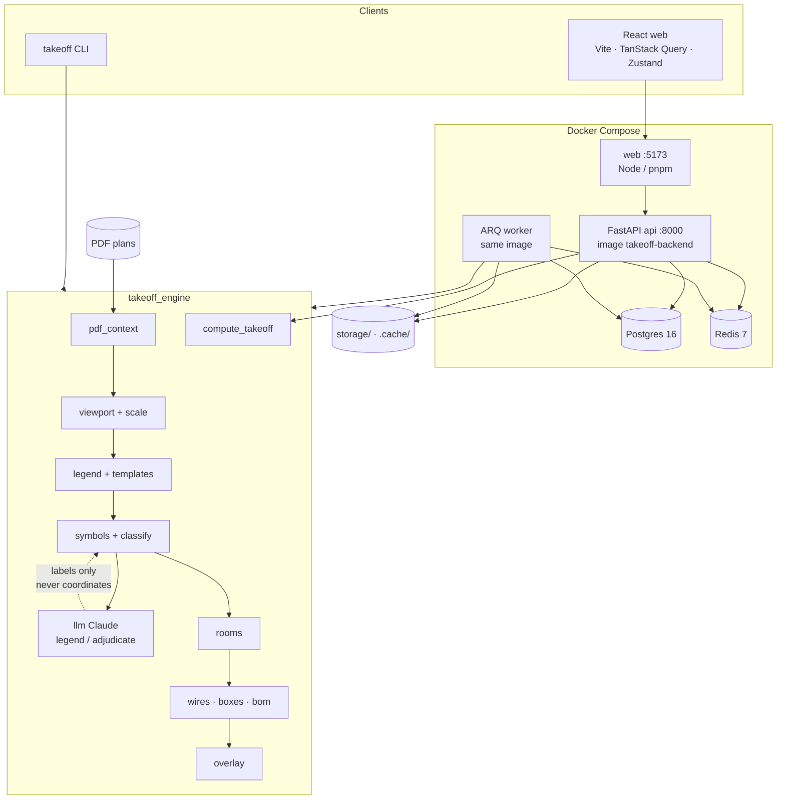
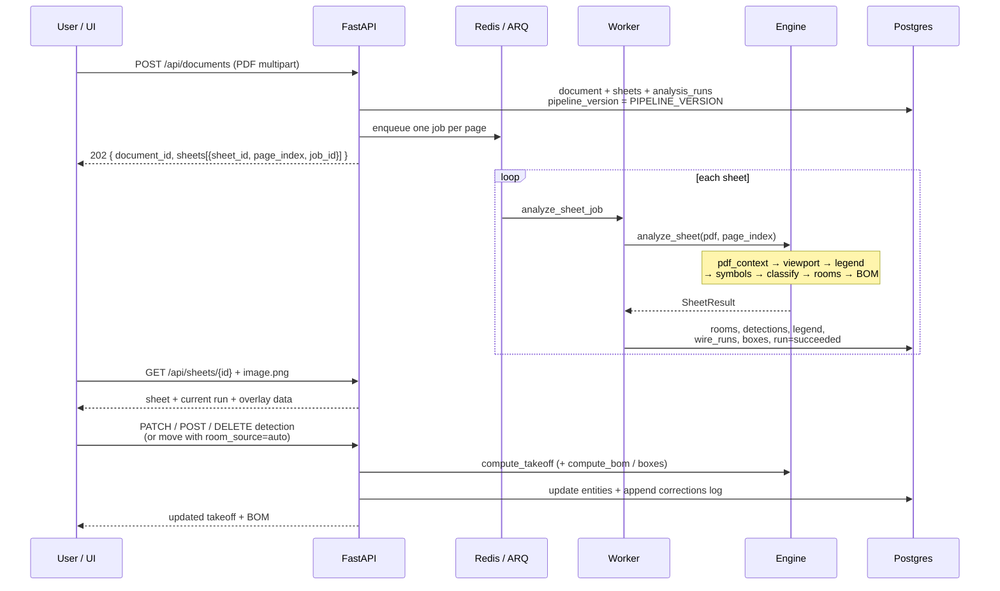

# Architecture

Technical overview for **AI Electrical Takeoff**. Contracts:
`engine/takeoff_engine/models.py`. Counting: only `compute_takeoff` (frontend mirror:
`web/src/lib/takeoff.ts`). Spec: [`SPEC.md`](SPEC.md). Decisions:
[`../coordination/DECISIONS.md`](../coordination/DECISIONS.md).

---

## Component diagram

### Why hybrid (not “send the whole plan to a vision model”)

Plans are **fully vector**. Geometry gives exact positions; vision LLMs miscount dense
symbols, drift in coordinates, and cost more. Claude is used only for **WHAT**
(legend rows, ambiguous candidates). Coordinates always come from PyMuPDF primitives.

---

## Data flow: upload → job → engine → DB → UI → corrections

### Idempotency and versioning

Re-upload of the same file hash reuses a **succeeded** run for
`(file_hash, page_index, pipeline_version)` when `pipeline_version` matches
`PIPELINE_VERSION` in `engine/takeoff_engine/__init__.py`. Engine behavior changes
bump that semver (after Santiago’s approval from v0.4.0) so clients never get stale
marks for a new pipeline.

Re-analyze creates a **new** run; previous runs and corrections are not mutated.

---

## Engine pipeline (per sheet)

| Step | Module | Owner | Role |
|------|--------|-------|------|
| 1 | `pdf_context` | A1 | Styled segments/fills, words/spans |
| 2 | `viewport` | A2 | Electrical cell + scale |
| 3 | `legend` | A2 | Rows + templates; optional LLM interpret |
| 4 | `symbols` / `classify` | A2 | Candidates → detections + codes |
| 5 | `llm.adjudicate` | A4 | Optional labels for `needs_review` |
| 6 | `rooms` | A3 | Polygons + room assignment |
| 7 | `wires` / `boxes` / `bom` | A8 | Optional BOM |
| 8 | `overlay` | A7 | Debug / eval PNGs |
| — | `compute_takeoff` | A1 | Pure counts |

CLI: `takeoff analyze --page N` with **N = plan number 1..4** → `page_index = N - 1`.

---

## Backend and frontend

- **API:** FastAPI, SQLAlchemy 2 async, Alembic, ARQ. Image cache under `.cache/`;
  PDFs under `storage/`. Feature flags: `ENABLE_LLM`, `ENABLE_BOM`, `ENGINE=real|fake`.
- **UI:** React + Vite; SVG overlay `viewBox` = electrical viewport in PDF points
  (no coordinate remapping bugs). Takeoff table click highlights matching marks.
  Optimistic CRUD with rollback; shared color palette with `overlay.py` (SPEC §10).

---

## Principles

1. Geometry = **where**; legend + Claude = **what**. Claude never returns coordinates.
2. `compute_takeoff` is the only counting path.
3. Contracts are frozen; Agente 1 owns schema/TS regeneration.
4. Corrections are append-only; re-analysis never silently overwrites a corrected run’s history.
5. Engine freeze from **v0.4.0**: behavior changes only with Santiago’s approval (`AGENTS.md` §14).
