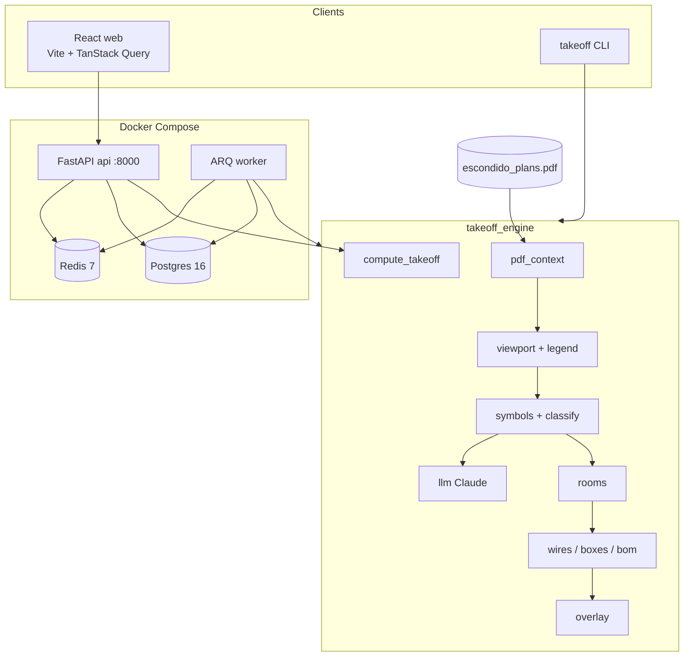
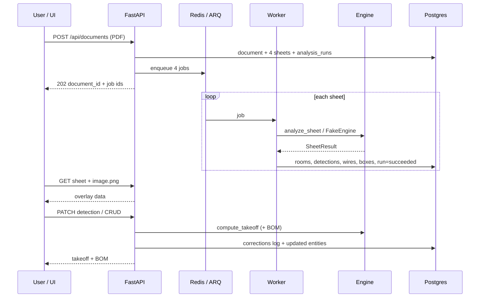

# Architecture

Technical overview for AI Electrical Takeoff. Contracts live in
`engine/takeoff_engine/models.py`; counting is only `compute_takeoff`.

## Component diagram

## Data flow: upload → corrections

## Principles

1. Geometry decides **where**; legend + Claude decide **what**. Claude never returns coordinates.
2. `compute_takeoff` is the only counting path (mirrored in `web/src/lib/takeoff.ts`).
3. Contracts are frozen; Agente 1 regenerates `contracts/schema.json` and `web/src/types/contracts.ts`.
4. Re-analysis creates a new run; corrections are append-only.
5. Feature flags: `ENABLE_LLM`, `ENABLE_BOM`, `ENGINE=fake|real`.
