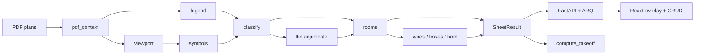

# Architecture

High-level data flow (Agente 1). Details live in `docs/SPEC.md`.

## Principles

1. Geometry decides **where**; legend + Claude decide **what**. Claude never returns coordinates.
2. `compute_takeoff` is the only counting path (engine + mirrored in the frontend).
3. Contracts in `engine/takeoff_engine/models.py` are frozen; changes go through Agente 1.
